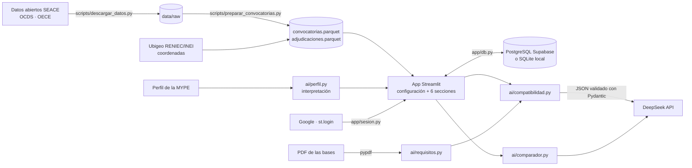

# 📋 LicitaPYME

> **Ayudamos a las MYPE peruanas a encontrar, evaluar y priorizar contrataciones con el Estado, con IA que lee cada convocatoria y les dice si les conviene, cuánto se suele pagar y quién suele ganar.**

🔗 **Demo:** https://licitapyme-emfn6lybxg7lpexwrdbzxz.streamlit.app/ · 🎥 **Video de respaldo:** _(pendiente)_ · 📐 [Metodología](docs/metodologia.md)

---

## 1. One-liner
Hacemos que una MYPE sepa **a qué convocatorias del Estado le conviene postular** mediante IA que evalúa su compatibilidad con datos abiertos del SEACE.

## 2. Founder


**Luz Estefany Ruiz de la Vega Tenorio** — estudiante de la Universidad del Pacífico.

**Por qué yo:** trabajo en una empresa que ejecuta un proyecto de conectividad rural financiado y supervisado por el Estado, así que veo de cerca cómo se contrata en el sector público: plazos, bases, requisitos y aprobaciones. Sé lo difícil que es entender esas reglas incluso para una empresa grande; para una MYPE sin área de licitaciones, es casi imposible. Uno mi experiencia con el sector público con lo que aprendí de datos e IA para traducir el SEACE en decisiones simples.

<br clear="left">


Cómo cubro cada rol con agentes de IA:
- **Producto y diseño:** definí el flujo con base en las conversaciones con usuarios; Claude Code prototipó las pantallas.
- **Ingeniería:** Claude Code como co-founder técnico (ver sección 9).
- **Ventas:** el propio producto genera el argumento de venta: "esta convocatoria es para ti, así se paga y estos ganan".

## 3. Problema
**Quién lo sufre:** micro y pequeñas empresas de servicios y bienes (limpieza, útiles, uniformes, mantenimiento) que quieren venderle al Estado pero no tienen un área de licitaciones.

**Lo que dicen los datos** (SEACE, ago–oct 2026):
- **13,455 procesos** publicados en solo dos meses y medio: imposible revisarlos a mano.
- El **37 %** no publica el valor referencial: la MYPE no sabe si le alcanza la capacidad.
- La búsqueda por palabras confunde: "limpieza" devuelve **obras de limpieza pública** o **geotextiles**.

**Cómo lo resuelven hoy:** revisando a mano las plataformas o las páginas de cada municipalidad, y sobre todo por contactos: *"Entre empresarios nos pasamos la voz cuando sabemos que una entidad está buscando algún producto"* (conversación 1, empresa proveedora de municipalidades). Quien recién empieza y no tiene contactos queda en desventaja.

**Cuánto les cuesta:**
- **Tiempo perdido** revisando convocatorias que al final no pueden atender por cantidad, especificaciones o lugar de entrega: *"A mí me ayudaría a no perder tiempo revisando convocatorias que al final no puedo atender."*
- **Oportunidades perdidas** por no enterarse a tiempo. En limpieza de oficinas, un contrato adjudicado tiene una mediana de **~S/ 488 mil** (datos del SEACE, 2024–2026).
- _Pendiente: cuantificar horas por semana con más conversaciones._

**Evidencia** (en [`docs/research/`](docs/research/)):
- [Conversación 1](docs/research/01-proveedora-municipal.md): persona con una empresa que vende a municipalidades y conoce a proveedores de varios rubros (WhatsApp, 16/11/2026).
- [Investigación documental](docs/research/investigacion_documental.md): perfiles de MYPE (cereales para Vaso de Leche, distribuidora de alimentos, ferretería) construidos con información pública. **No son entrevistas**: son hipótesis para contrastar.
- Conversaciones adicionales en curso.

## 4. Solución e insight
LicitaPYME responde 5 preguntas:

| Pregunta | Cómo |
|---|---|
| ¿Qué oportunidades hay para mi empresa? | Búsqueda por rubro oficial (CUBSO) + perfil de la empresa |
| ¿Dónde están? | Mapa interactivo con agrupación y fichas |
| ¿Qué tan compatible soy? | IA que evalúa 7 criterios con una **metodología fija y documentada** |
| ¿Qué necesito para postular? | La IA lee las bases (PDF) y **verifica cada requisito contra el texto, con su página** |
| ¿Cuál priorizo? | Comparador con IA + precios históricos, entidades y proveedores adjudicados |
| ¿Cómo preparo la postulación? (Premium) | Para la convocatoria más compatible: checklist de documentos (desde las bases verificadas), carta de presentación redactada solo con los datos del perfil y borrador de cotización con referencias de precio, en un Word donde lo que falta queda resaltado como **[COMPLETAR]** |

**Insight:** el SEACE es público pero ilegible. El valor no está en los datos, sino en traducirlos a "esta te conviene, por esto, y esto se suele pagar". Y la IA solo es útil si **no inventa**: por eso el porcentaje lo calcula una fórmula, la falta de información no se castiga y cada requisito se verifica contra el PDF.

## 5. Why now
- **Datos abiertos OCDS** del Estado peruano disponibles en formato estándar y masivo.
- **LLMs baratos y con salida estructurada** (JSON validable): evaluar una convocatoria cuesta fracciones de céntimo.
- **Agentes de código**: una sola persona puede construir esto en días.

## 6. Demo

### Experiencia de uso
1. **La empresa se presenta**: asistente de 3 pasos (datos, productos y servicios, cobertura y capacidad). Cada paso se guarda: si cierras la app, continúas donde te quedaste.
2. **La IA interpreta el perfil**: resume actividades y productos, y sugiere palabras clave y categorías del catálogo del Estado (CUBSO). Cada sugerencia se prueba contra las convocatorias reales y se descartan las que no encuentran nada. La IA no agrega experiencia ni capacidades que no declaraste.
3. **Dashboard personalizado**: convocatorias abiertas, coincidencias, cobertura, evaluadas y altamente compatibles; recomendaciones de la IA con su razón; resumen por departamento; actividad reciente.
4. **Explorar y decidir**: mapa, búsqueda, requisitos desde las bases, comparador y análisis del mercado.

El perfil, las oportunidades guardadas, los estados, el historial y las evaluaciones se **guardan en una base de datos** y se recuerdan en la próxima visita. Una misma cuenta puede registrar **varias empresas** y cambiar entre ellas desde el menú lateral; los datos de cada una están separados. En la nube se ingresa con **Google**; también hay un modo de ejemplo sin registro. Guía de publicación: [docs/despliegue.md](docs/despliegue.md).

### Cómo correrlo en local
```bash
pip install -r requirements.txt
python scripts/descargar_datos.py          # datos abiertos del SEACE (~155 MB, no se suben al repo)
python scripts/preparar_convocatorias.py   # genera data/convocatorias.parquet y data/adjudicaciones.parquet
cp .env.example .env                       # y pon tu DEEPSEEK_API_KEY
streamlit run app/app.py
```
Los archivos procesados ya están en `data/`, así que basta con el último paso para ver la app.

**Pruebas:** `python -m pytest tests -q` (42 pruebas, base de datos temporal, sin consumir la API de IA):
estados del perfil (nuevo, incompleto, confirmado), entrada directa al dashboard, crear, editar y cambiar
de empresa, separación de datos entre empresas y usuarios, conservación de guardadas e historial al editar,
y las 6 secciones con 5 perfiles distintos (incluidos casos sin resultados o con un solo resultado).

### Capturas
_(pendiente: 3 capturas en `docs/` — mapa, evaluación con IA, análisis del mercado)_

### Arquitectura


### Modelos y APIs
| Qué | Por qué |
|---|---|
| **DeepSeek** (`deepseek-flash`) vía API compatible con OpenAI, modo JSON | Muy barato para leer cientos de convocatorias; el JSON se valida con Pydantic |
| **pypdf** | Extrae el texto de las bases para que la IA cite páginas y podamos verificar cada cita |
| **Folium + MarkerCluster** | Mapa interactivo con agrupación de puntos |
| **Plotly** | Gráficos de precios y entidades |

## 7. Modelo de negocio
| Plan | Precio | Para quién | Qué incluye |
|---|---|---|---|
| Básico | **S/ 15 / mes** | MYPE que recién empieza a venderle al Estado | Búsqueda por rubro, mapa y 10 evaluaciones con IA al mes |
| Premium | **S/ 49 / mes** | MYPE que ya postula | Evaluaciones ilimitadas, lectura de bases, comparador, análisis del mercado, varias empresas por cuenta y **Preparar postulación**: checklist de documentos, carta de presentación y borrador de cotización en Word |

**Por qué estos precios:** en la [conversación 1](docs/research/01-proveedora-municipal.md), una persona que vende a
municipalidades propuso *"unos 15 soles al mes, para probar"* para quien recién empieza y *"unos 50 soles. Incluso 60"*
para quien ya consigue contratos. Elegimos dos planes para que la decisión de compra sea simple.

**Costo por usuario (plan Premium, estimado).** Tokens medidos en pruebas; precio de DeepSeek `deepseek-flash` en horario pico
(el más caro): USD 0.30 por millón de tokens de entrada y USD 1.20 por millón de salida. Tipo de cambio ~S/ 3.75.

| Uso mensual de un usuario Premium | Tokens por uso (entrada / salida) | Costo |
|---|---|---|
| 100 evaluaciones de compatibilidad | ~600 / ~1,000 | ~S/ 0.52 |
| 10 lecturas de bases en PDF | ~40,000 / ~3,000 | ~S/ 0.59 |
| 10 comparaciones + 2 análisis de perfil | ~2,000 / ~1,500 | ~S/ 0.10 |
| **IA total** | | **~S/ 1.20** |
| Servidor y base de datos (Supabase Pro USD 25 repartido en 100 usuarios) | | ~S/ 0.95 |
| Comisión de cobro con tarjeta (~4 %) | | ~S/ 1.96 |
| **Costo total por usuario** | | **~S/ 4.10** |

**Margen de contribución del plan Premium: ~S/ 45 de S/ 49 (~92 %).** En el plan Básico, 10 evaluaciones cuestan
~S/ 0.05 en IA; con servidor (~S/ 0.95) y comisión (~S/ 0.60), el costo es ~S/ 1.60 y el margen ~S/ 13.40 (~89 %). Precios de la API según la página oficial de DeepSeek (verificar
antes de escalar: cambian con cada versión del modelo).

**Argumento de venta:** si LicitaPYME te ayuda a ganar un contrato de limpieza (mediana adjudicada: ~S/ 488 mil), la suscripción anual se paga cientos de veces.

## 8. Herramientas del curso
| Herramienta | Para qué | Dónde está |
|---|---|---|
| **APIs y datos abiertos** (sesión 03) | Ingesta masiva de convocatorias y adjudicaciones del SEACE (OCDS) | [`scripts/`](scripts/) |
| **Dashboards** (sesión 05) | Inicio, búsqueda y análisis del mercado | [`app/paginas/`](app/paginas/) |
| **Mapas con Folium** (sesión 06) | Mapa de oportunidades con ubigeo y agrupación | [`app/paginas/mapa.py`](app/paginas/mapa.py) |
| **LLMs con salidas estructuradas** (sesión 08) | Compatibilidad (7 criterios), interpretación del perfil, requisitos, comparador y carta de presentación (Premium), validados con Pydantic | [`ai/`](ai/) |
| **Document AI** (sesión 10) | Lectura de las bases en PDF con verificación de citas | [`ai/requisitos.py`](ai/requisitos.py) |

## 9. Qué hizo el agente
Construido con **Claude Code** como co-founder técnico:
- Exploró los datos OCDS y encontró qué campos sirven (y cuáles no: el "periodo de ofertas" no es una fecha límite).
- Escribió la ingesta, el cruce con ubigeo y la tabla de adjudicaciones.
- Diseñó e implementó la metodología de compatibilidad, la verificación de requisitos y el comparador.
- Construyó las 6 páginas de la app y las probó en el navegador, corrigiendo errores (hilos sin contexto de Streamlit, respuestas de la IA cortadas por límite de tokens, mapa base que pedía API key).
- Rediseñó la experiencia: configuración inicial con IA, persistencia en base de datos, inicio de sesión con Google, varias empresas por cuenta y sistema visual propio (Inter, azul marino, componentes en `app/ui.py`).
- Al probar el flujo con una empresa de abarrotes detectó que "arroz" coincidía con "carrozable" (133 falsos positivos) y cambió la búsqueda a coincidencia por inicio de palabra.
- Escribió 42 pruebas automáticas (`tests/`).

Mis decisiones como founder: elegir el problema y el usuario, priorizar el alcance para la demo, validar con usuarios y definir el modelo de negocio.

## Limitaciones
Ver la sección 7 de la [metodología](docs/metodologia.md): datos mensuales (corte 02/10/2026), sin lugar de ejecución ni fecha de ofertas en los datos abiertos, alertas y carpeta digital en la hoja de ruta.

## Qué sigue
1. Fuente diaria del SEACE y **alertas** por correo/WhatsApp.
2. **Carpeta digital** segura de la empresa que se compare con los requisitos de las bases.
3. OCR para bases escaneadas.

---
Datos: SEACE/OECE vía Open Contracting Partnership · Ubigeo: jmcastagnetto/ubigeo-peru-aumentado (MIT) · Licencia del código: MIT
